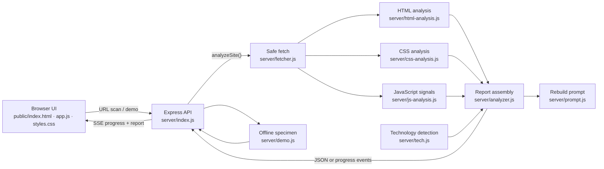

# webcopy

> **Motion forensics for the web.**
> Read a page’s shipped source. See its motion, design system, structure, and assets in one clear report.

[Open webcopy](https://webcopy-nu.vercel.app)

Paste a public website URL into webcopy to inspect the HTML, CSS, and JavaScript it delivers. Get a browsable report, downloadable JSON, and a copy-ready reconstruction prompt.

webcopy reads source files statically. It does not run the target site, render it in a browser, or take screenshots.

---

## What you get

- **Motion ledger** — keyframes, animation assignments, transitions, easing, scroll behavior, motion libraries, runtime motion signals, and reduced-motion coverage.
- **Design ledger** — colors, typefaces, typography specimens, spacing and type scales, font files, radii, shadows, gradients, breakpoints, and CSS custom properties.
- **Asset inventory** — images, video, embeds, fonts, stylesheets, scripts, CSS assets, metadata images, links, and external domains.
- **Page structure** — metadata, headings, landmarks, forms, frameworks, CMS hints, and JSON-LD.
- **Source notes** — response status, byte counts, fetch outcomes, warnings, and analysis limits.
- **Rebuild prompt** — a copy-ready brief assembled from the report, with design, content structure, assets, and motion details.

The motion score describes how much motion appears in the source. It is not a rating of visual quality, performance, or accessibility.

## Try it locally

**Requirements:** Node.js 20.11 or later.

```bash
git clone <your-repository-url>
cd webcopy
npm install
npm start
```

Open [http://localhost:4173](http://localhost:4173). For auto-restart while editing, run `npm run dev`.

No frontend build step is required. The Express server serves the files in `public/` directly.

To try the built-in Aurelia Studio specimen without fetching another site, choose a specimen/demo action in the interface or request `/api/demo`.

## Architecture



### A scan, step by step

1. **The browser starts a scan.** The interface validates the URL and opens an event stream so it can show progress and let the user cancel.
2. **The API applies request controls.** Express handles JSON and streaming routes, applies response security headers, compresses normal responses, and limits scans per client IP.
3. **The fetcher reads the public page.** It normalizes the URL, follows redirects safely, rejects private/local network targets by default, and applies response-size and timeout limits.
4. **The analyzers inspect delivered source.** Cheerio parses the HTML. The HTML analyzer inventories structure and linked resources; CSS and JavaScript analyzers extract declarations and recognizable source signals. External resources are fetched within per-type limits.
5. **The report assembler combines findings.** It joins motion, design, asset, structure, technology, statistics, warnings, and the generated rebuild prompt into one report object.
6. **The browser presents the result.** The front end renders searchable report sections and offers JSON and prompt copy/download actions. Report strings and URLs are treated as untrusted input and validated before display.

### Repository map

```text
webcopy/
├── public/                  # Browser app: HTML, CSS, JavaScript, favicon, 404 page
├── server/
│   ├── index.js             # Express app, API routes, SSE, rate limiting, headers
│   ├── fetcher.js           # URL normalization, safe network fetches, fetch errors
│   ├── analyzer.js          # Scan orchestration and final report assembly
│   ├── analyzer-utils.js    # Shared URL, text, and collection helpers
│   ├── html-analysis.js     # HTML structure, metadata, links, and asset inventory
│   ├── css-analysis.js      # Motion declarations and design-token extraction
│   ├── js-analysis.js       # Static JavaScript motion and scroll signal detection
│   ├── tech.js              # Framework, CMS, and library detection
│   ├── prompt.js            # Copy-ready reconstruction prompt generation
│   └── demo.js              # Offline Aurelia Studio report specimen
├── test/                    # Node test suites for frontend and analyzer behavior
├── .env.example             # Supported environment variables
├── package.json
└── README.md
```

## Run configuration

Copy `.env.example` to `.env` and adjust values as needed:

```dotenv
PORT=4173
ALLOW_PRIVATE=0
RATE_LIMIT_PER_10M=60
NODE_ENV=development
```

| Variable | Purpose |
| --- | --- |
| `PORT` | Local server port. Defaults to `4173`. |
| `ALLOW_PRIVATE` | Set to `1` to permit localhost/private targets for development. Keep disabled for public deployments. |
| `RATE_LIMIT_PER_10M` | Maximum scans per client IP in a rolling 10-minute window. Defaults to `60`. |
| `NODE_ENV` | In production, static assets receive a one-hour cache age. |

Keep real credentials and local `.env` files out of Git. The supplied `.gitignore` excludes them.

## HTTP API

| Method and route | Behavior |
| --- | --- |
| `GET /api/health` | Returns service health and version. |
| `GET /api/demo` | Returns the complete offline specimen report. |
| `GET /api/analyze?url=<url>` | Analyzes a URL and returns JSON. Add `demo=1` for the specimen. |
| `POST /api/analyze` | Analyzes JSON body `{ "url": "https://example.com" }`. Use `{ "demo": true }` for the specimen. |
| `GET /api/analyze/stream?url=<url>` | Streams progress and then a result or failure as Server-Sent Events. |
| `GET /api/analyze/stream?demo=1` | Streams the specimen with progress events. |

A successful scan returns the report object. A failed request uses a stable error shape:

```json
{
  "error": {
    "message": "That page could not be read.",
    "code": "FETCH_FAILED",
    "detail": ""
  }
}
```

Streaming events have a `type` of `progress`, `result`, or `fail`. If a client disconnects, the active fetch is aborted where supported.

## Safety and scan boundaries

- Only public `http(s)` pages are supported. Authentication and login flows are not.
- Local and private network targets are blocked by default to reduce server-side request forgery risk. `ALLOW_PRIVATE=1` is intended for local development only.
- The HTML document is capped at 5 MB; each external stylesheet at 1.2 MB; each external script at 950 KB.
- A scan reads up to 14 linked stylesheets, 14 linked scripts, and 6 CSS imports. The report includes warnings when resources fail or limits are reached.
- Source is analyzed statically. Browser-computed styles, executed scripts, shadow DOM, cross-origin iframe contents, canvas frames, and video contents are outside the scan.
- Reports are assembled in memory and returned to the requester; this application does not persist scan reports.

## Development

```bash
npm run dev
```

The server watches for changes. The test suites use Node’s built-in test runner:

```bash
npm test
```

## License

MIT
